# Parcial práctico 2FA — Desarrollo Web (UTP)

Sistema de registro e inicio de sesión con **autenticación de dos factores (2FA)** hecho en
**PHP + MySQL + Google Authenticator** (estándar TOTP). Universidad Tecnológica de Panamá,
Facultad de Ingeniería en Sistemas, Desarrollo Web, II Semestre 2026.

La base de las clases (`mod_db`, `SanitizarEntrada`, `ValidacionLogin`, `loginfunciones`) viene del
repositorio `EjemploLogin` visto en clase; aquí se amplió con 2FA, protección CSRF y validaciones.

## Contenido

1. [Cómo funciona](#cómo-funciona)
2. [Instalación](#instalación)
3. [Recorrido con capturas](#recorrido-con-capturas)
4. [Seguridad implementada](#seguridad-implementada)
5. [Estructura del proyecto](#estructura-del-proyecto)
6. [Notas y limitaciones](#notas-y-limitaciones)

---

## Cómo funciona

```
Registro ──► Escanear QR ──► Login (usuario + contraseña) ──► Código 2FA ──► Panel
registro.php  qr_registro.php   login.php                    verificar_2fa.php  panel.php
```

1. **Registro:** el usuario llena el formulario; el servidor genera su `secret_2fa`, lo guarda y
   **vincula el correo con Google Authenticator** en ese mismo momento.
2. **QR:** se muestra el código QR (y la clave manual) para agregarlo a Google Authenticator.
3. **Login, fase 1:** correo o nombre de usuario + contraseña. Si son correctos **todavía no se entra al
   sistema**: se pasa a la segunda pantalla.
4. **Login, fase 2:** el usuario escribe el código de 6 dígitos de la app. Solo si es válido se abre el panel.
5. Cada fase abre una **sesión nueva** (`session_regenerate_id`), de modo que el panel demuestra que
   ambas fases se completaron.

---

## Instalación

**Requisitos:** PHP 8.0+ (con `pdo_mysql` y `mbstring`), MySQL 8, Apache (WAMP en Windows) y la app
**Google Authenticator** en el celular. La librería `sonata-project/google-authenticator` ya viene en
`vendor/`, así que Composer es opcional.

1. **Clonar o copiar** el proyecto en `C:\wamp64\www\Parcial2FA` e iniciar WAMP (ícono verde).
2. **Crear la base de datos y los usuarios MySQL** desde phpMyAdmin (`http://localhost/phpmyadmin`),
   pestaña **Importar**, en este orden:
   - `sql/01_crear_bd_y_tablas.sql` — base `parcial2fa`, tablas `usuarios` e `intentos_login`, y el
     `ALTER TABLE` de la guía que agrega `secret_2fa`.
   - `sql/02_usuarios_privilegios_minimos.sql` — crea los usuarios `app2fa_web` y `app2fa_lectura`.
   - `sql/03_agregar_nombre_usuario.sql` — **solo** si tu base ya existía de una versión anterior
     (agrega la columna `NombreUsuario`). En una instalación nueva el paso 1 ya la incluye.
3. **Configurar la conexión:** copia `config/config.example.php` como `config/config.php` y escribe las
   contraseñas de los dos usuarios MySQL (deben coincidir con las de `02_usuarios_privilegios_minimos.sql`).
   `config.php` está en `.gitignore` para no subir contraseñas al repositorio.
4. **Abrir** `http://localhost/Parcial2FA/registro.php`.

Si algo falla, revisa `C:\wamp64\logs\php_error.log` y `C:\wamp64\logs\apache_error.log`.

---

## Recorrido con capturas

Todas las capturas se tomaron ejecutando la aplicación real (WAMP, Edge y MySQL 8.4) con una cuenta de
demostración (`demo.2fa@example.com`) que se eliminó después. Están en [`docs/capturas/`](docs/capturas/).

### 1. Registro y validaciones del lado del cliente

El botón **Registrarme** permanece deshabilitado hasta que todos los campos son válidos.

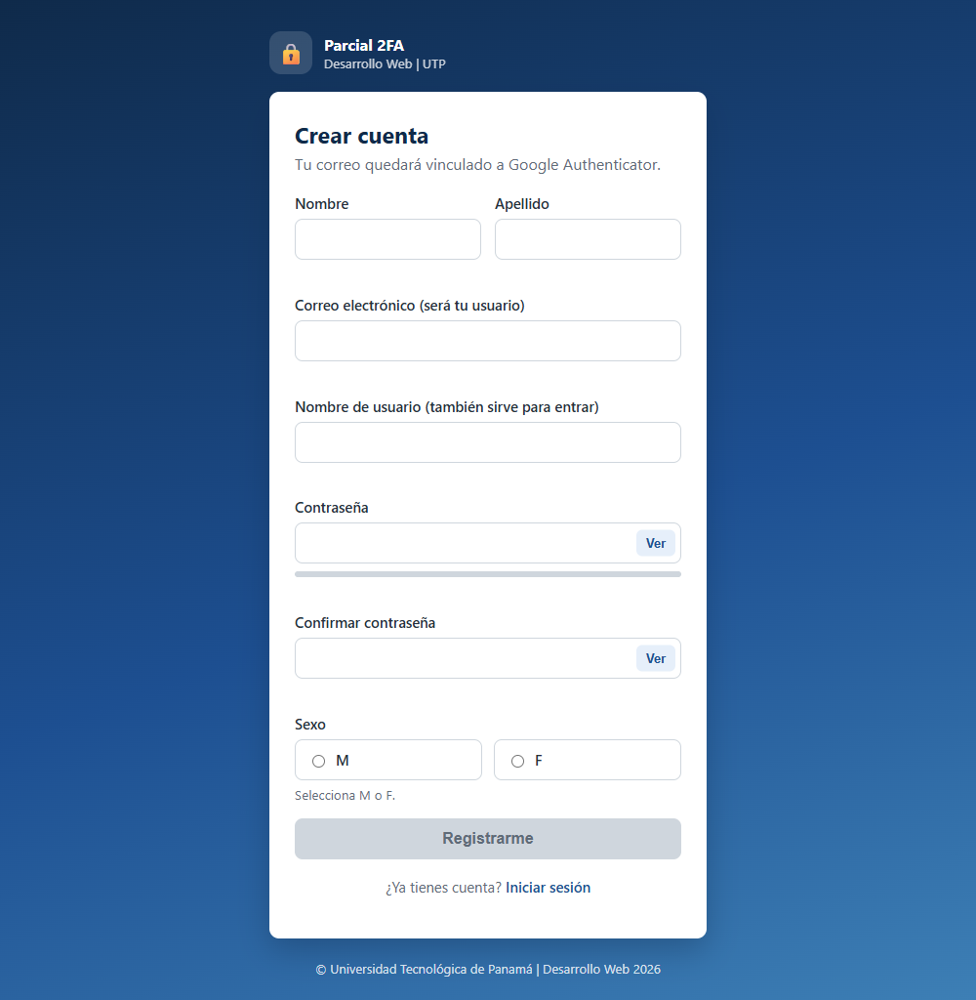

Validaciones en tiempo real: nombre solo con letras, correo con formato válido, usuario de 3 a 30
caracteres, contraseña mínima de 8 caracteres y confirmación que debe coincidir.


Con datos correctos: el correo y el usuario se consultan por AJAX ("disponible"), el medidor evalúa la
fuerza de la contraseña y el botón se habilita.

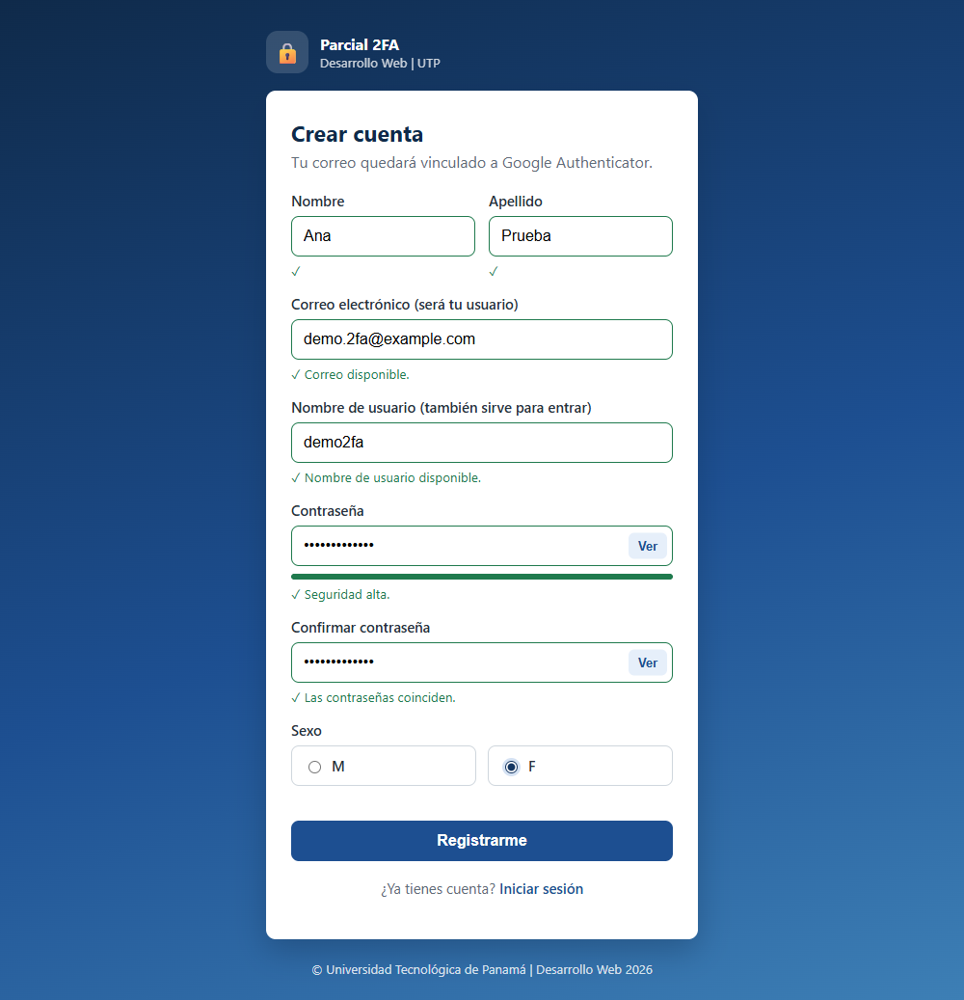

### 2. Correo y usuario duplicados

Mientras el usuario escribe, `js/registro.js` llama a `ajax/verificar_usuario.php`, que consulta con un
usuario MySQL de **solo lectura**. Si ya existe, el botón sigue deshabilitado. El servidor y el índice
`UNIQUE` de la base de datos vuelven a verificarlo al guardar.


### 3. Protección Anti-CSRF

Cada formulario incluye un token aleatorio guardado también en la sesión del servidor. Aquí se **borró el
campo oculto** `csrf_token` antes de enviar (lo que haría una página falsa de un atacante) y el servidor
rechazó la petición.

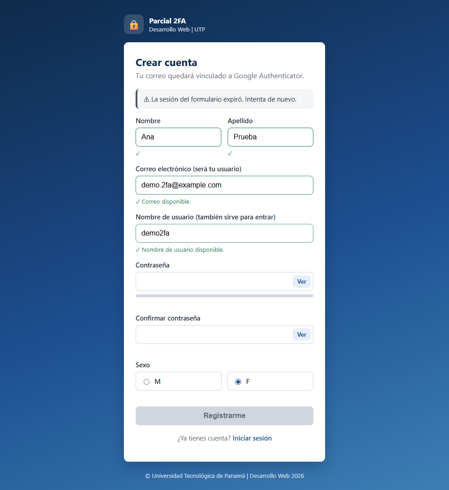

### 4. Generación del código QR

Al crear la cuenta se genera el `secret_2fa` y se muestra el QR para escanearlo con Google Authenticator.
Si no se puede escanear, se ofrece la clave manual.

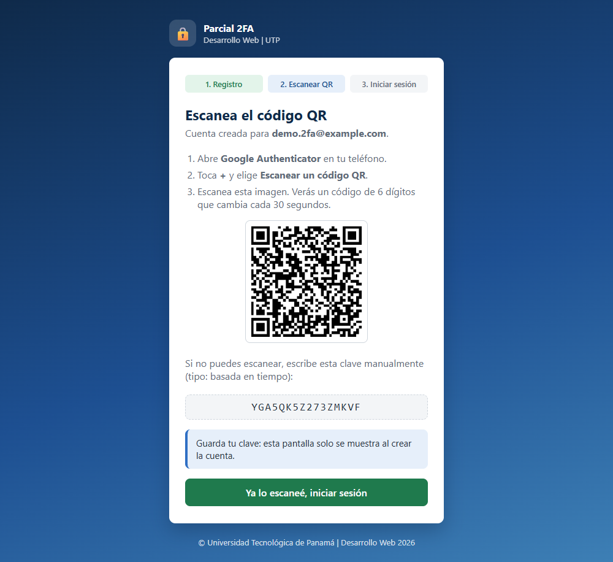

### 5. Inicio de sesión, fase 1: usuario y contraseña

Se puede entrar con el correo **o** con el nombre de usuario.

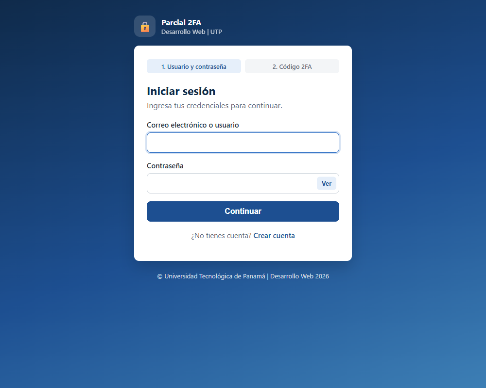

Contraseña incorrecta: mensaje genérico, sin revelar si el usuario existe. El intento queda registrado
en la tabla `intentos_login`.

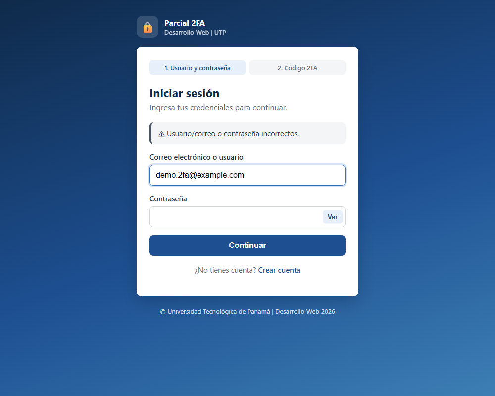

### 6. Inicio de sesión, fase 2: código de Google Authenticator

Con la contraseña correcta se pide el código antes de entrar.


Intentar abrir `panel.php` directamente sin haber validado el código **devuelve a esta misma pantalla**:

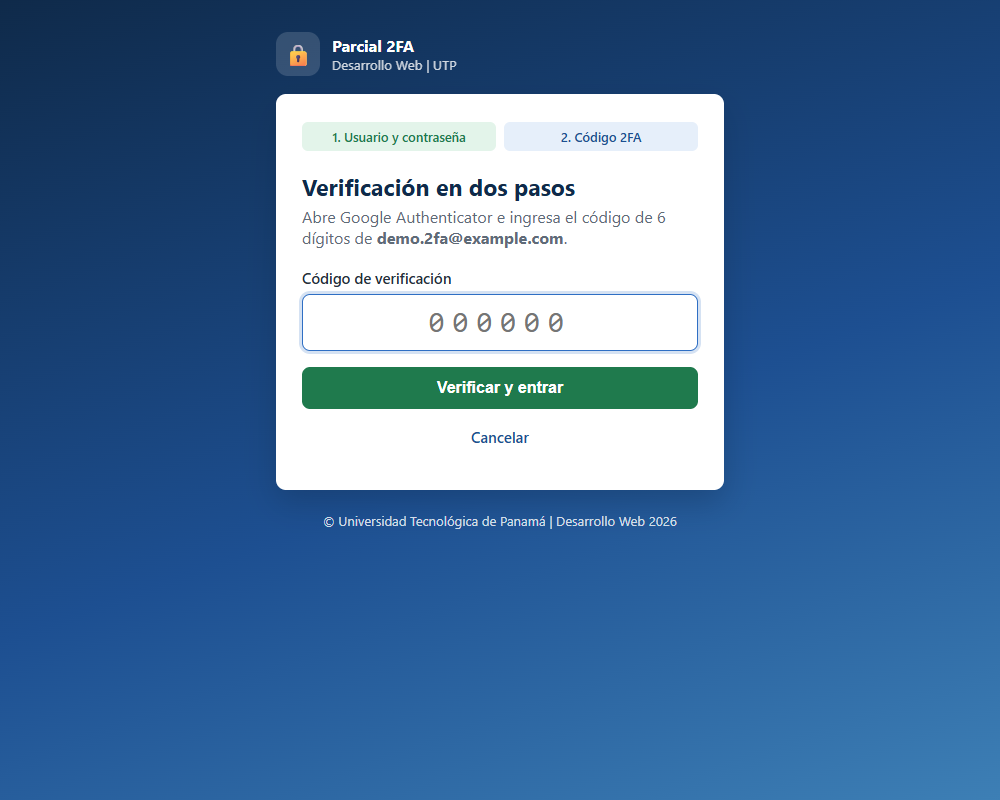

Código incorrecto: acceso denegado, con un máximo de 5 intentos.

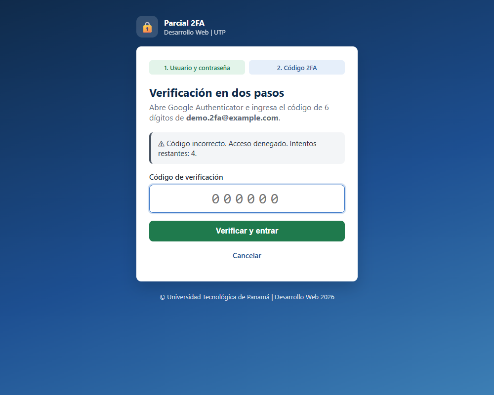

Código correcto: acceso concedido. El panel muestra las huellas de los dos IDs de sesión, que son
**distintos**: la sesión nueva confirma que la fase del código fue exitosa.

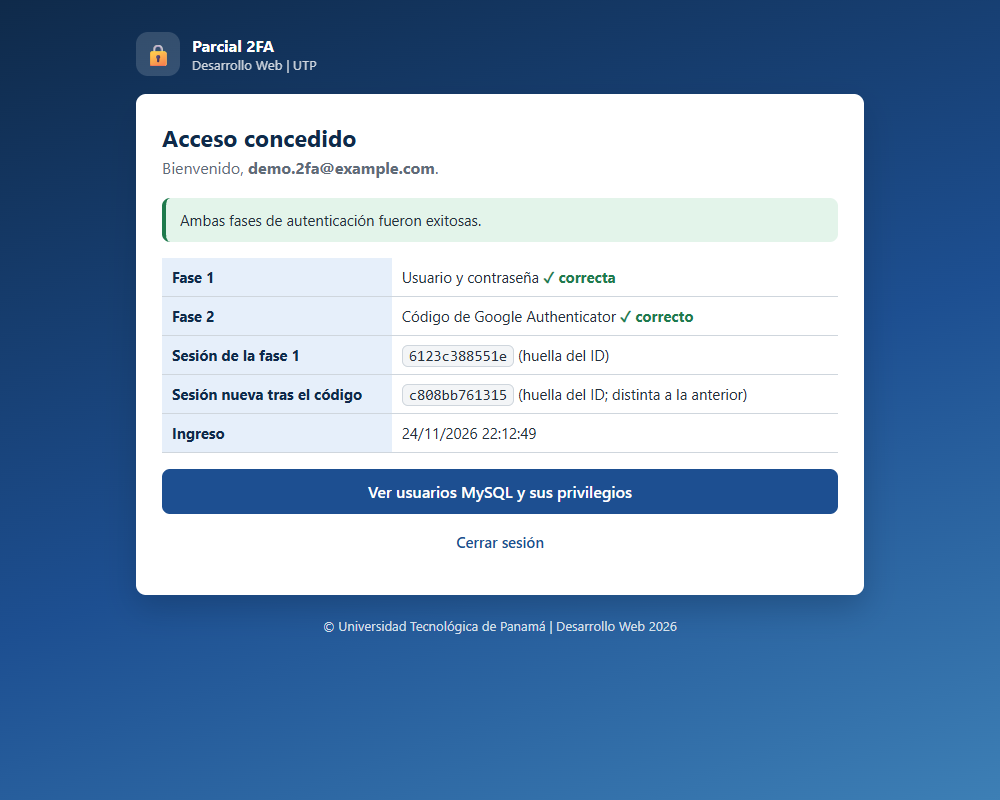

### 7. Usuarios MySQL con privilegios mínimos

La aplicación **no usa `root`**. Esta pantalla (`privilegios.php`) ejecuta `SHOW GRANTS` con cada usuario
y muestra lo que realmente tiene concedido.

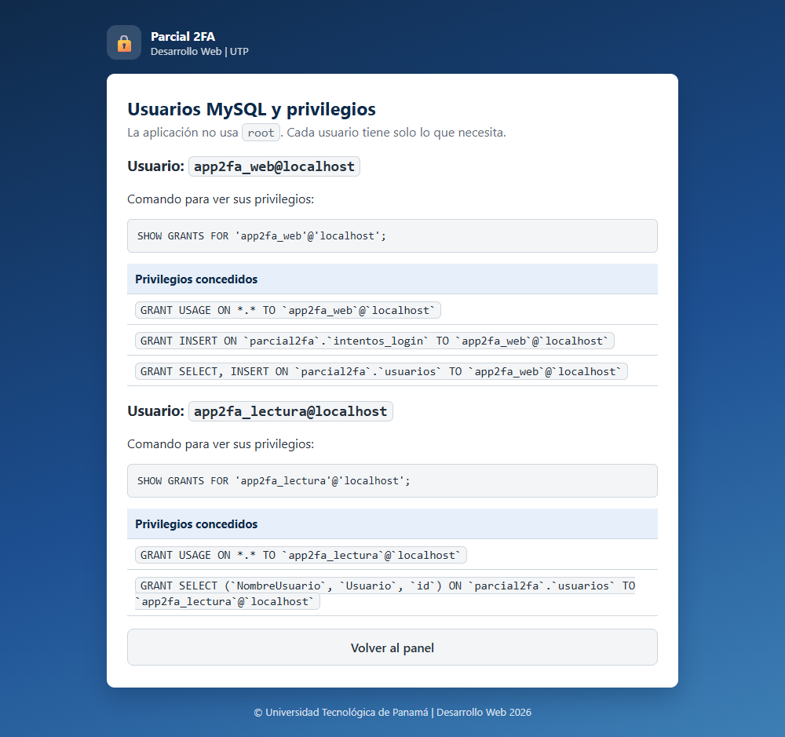

Los mismos comandos ejecutados directamente en MySQL:

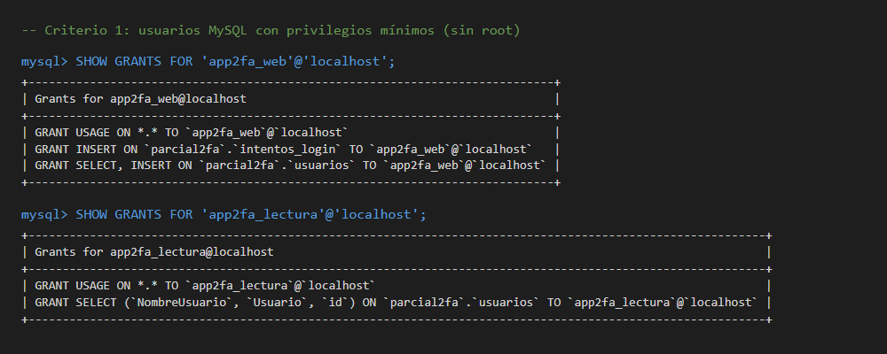

| Usuario | Privilegios | Uso |
|---|---|---|
| `app2fa_web` | `SELECT, INSERT` en `usuarios`; `INSERT` en `intentos_login` | Registro, login y bitácora |
| `app2fa_lectura` | `SELECT (id, Usuario, NombreUsuario)` en `usuarios` | Solo la validación de duplicados (AJAX) |

Ninguno puede hacer `UPDATE`, `DELETE`, `DROP` ni administrar el servidor.

### 8. Datos guardados en las tablas

La contraseña se guarda como **hash bcrypt** (nunca en texto plano) y `secret_2fa` se genera dinámicamente.

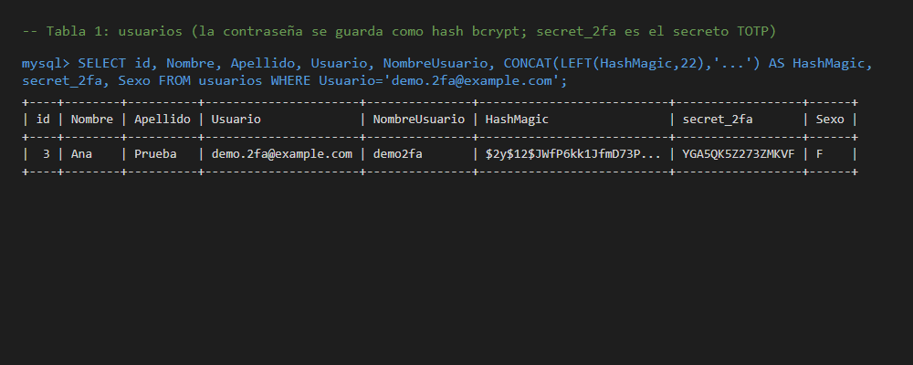

`intentos_login` registra cada intento con su IP (`deteccion_anomalia`: 1 = contraseña correcta,
0 = incorrecta). Los dos intentos de la demostración aparecen aquí: uno fallido y uno correcto.

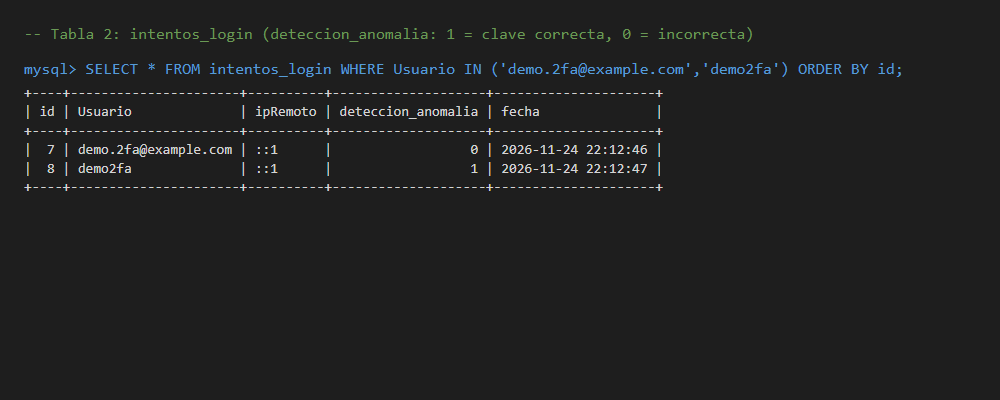

---

## Seguridad implementada

| Protección | Cómo |
|---|---|
| **Contraseñas** | `password_hash` con bcrypt (costo 12) detrás de la interfaz `IGeneradorHash` |
| **SQL Injection** | Solo sentencias preparadas (PDO, `ATTR_EMULATE_PREPARES = false`) |
| **XSS** | Entradas sanitizadas y toda salida escapada con `htmlspecialchars` |
| **CSRF** | Token aleatorio (`random_bytes`) en sesión + campo oculto, comparado con `hash_equals`; se regenera tras cada intento |
| **Fijación de sesión** | `session_regenerate_id(true)` al cambiar de fase; cookie `HttpOnly` y `SameSite=Lax` |
| **2FA** | TOTP de 6 dígitos; el panel exige ambas fases (`comunes/bloque_Seguridad.php`) |
| **Fuerza bruta** | 5 códigos incorrectos o 5 minutos sin completar la fase 2 → vuelve al login |
| **Enumeración de usuarios** | Mensaje genérico y mismo tiempo de cálculo si el usuario no existe |
| **Privilegios mínimos** | Dos usuarios MySQL con los permisos justos, sin `root` |

---

## Estructura del proyecto

```
Parcial2FA/
├── registro.php  qr_registro.php  login.php  verificar_2fa.php  panel.php
├── privilegios.php  salir.php  index.php
├── ajax/verificar_usuario.php        # duplicados en tiempo real (usuario MySQL de solo lectura)
├── clases/
│   ├── FormularioRegistro.php        # validación del formulario (un método = una responsabilidad)
│   ├── SanitizarEntrada.php          # 9 métodos estáticos de sanitización
│   ├── CSRFProtection.php            # tokens Anti-CSRF
│   ├── IGeneradorHash.php            # interfaz para generar y validar hashes
│   ├── HashBcrypt.php                # implementación con bcrypt
│   ├── Autenticador2FA.php           # envoltorio de sonata-project/google-authenticator
│   ├── RepositorioUsuarios.php       # consultas a la tabla usuarios
│   ├── objLoginAdmin.php             # ValidacionLogin
│   └── mysql.inc.php                 # conexión PDO por perfil (mod_db)
├── comunes/                          # init.php, bloque_Seguridad.php, plantilla.php, loginfunciones.php
├── config/                           # config.example.php (config.php no se sube a Git)
├── css/estilo.css  js/registro.js
├── sql/                              # 01 tablas, 02 usuarios MySQL, 03 migración
├── docs/capturas/                    # capturas de este README
└── vendor/                           # sonata-project/google-authenticator
```

`SanitizarEntrada` incluye: `limpiarCadena`, `limpiarEmail`, `limpiarUsuario`, `limpiarIdentificador`,
`limpiarNombre`, `limpiarSexo`, `limpiarCodigo`, `limpiarSecreto` (base32) y `escaparHtml`.

---

## Notas y limitaciones

- El QR se genera con `api.qrserver.com`, como en la guía: el secreto viaja a ese servicio. En producción
  conviene generarlo en el servidor.
- `secret_2fa` se guarda en texto plano, como indica la guía. En producción debería cifrarse.
- Las capturas de las tablas son salida real de MySQL (cliente de línea de comandos), filtrada a la
  cuenta de demostración.
